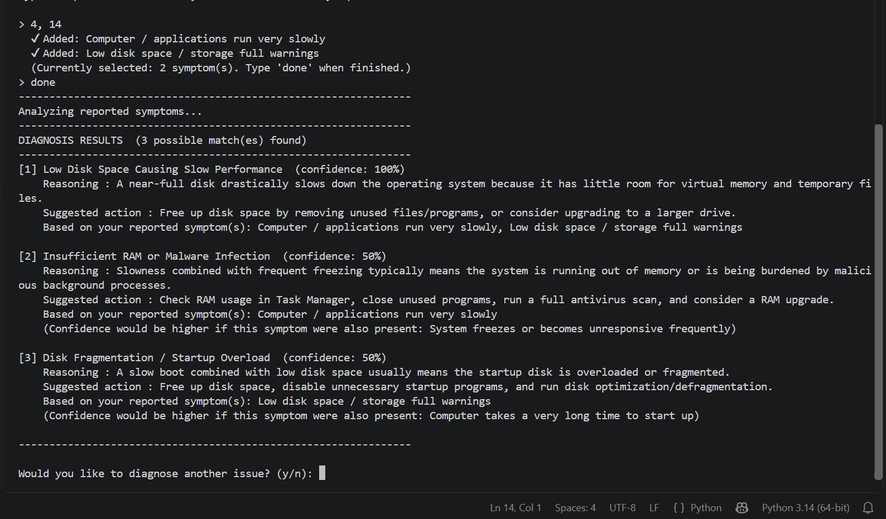
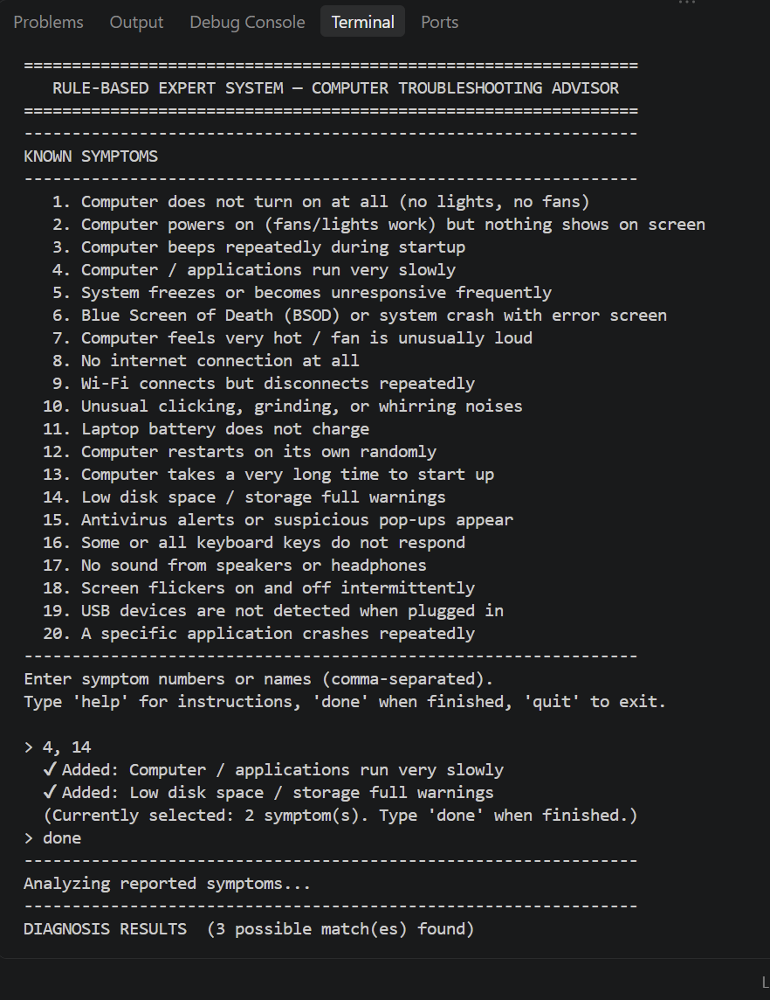

# AI_TE01_06

## Identitas Kelompok

- **Nama Kelompok:** AI_TE01_06
- **Mata Kuliah:** Kecerdasan Buatan
- **Manager:** Timothy Raney Yves Kaunang
- **Developer 1 — Expert System:** Tsabib Akdam Alkarny
- **Developer 2 — Search Algorithm:** Hosea Fransiskus Sinambela

## Struktur Repository

```text
AI_TE01_06/
├── Expert-System/
├── Search-Algorithm/
├── Multi-Agent-System/
└── README.md
```

## 1. Expert System

### Deskripsi
Program ini membantu menganalisis kemungkinan masalah komputer berdasarkan gejala yang dipilih pengguna. Sistem mencocokkan gejala dengan aturan dalam basis pengetahuan untuk menghasilkan diagnosis dan saran tindakan.

### Fitur
- Memilih satu atau beberapa gejala komputer.
- Menganalisis gejala menggunakan aturan yang tersedia.
- Menampilkan kemungkinan diagnosis, alasan, saran tindakan, dan skor confidence.

### Cara Menjalankan
**Persyaratan:** Python sudah terinstal.

1. Buka folder `Expert-System`.
2. Buka terminal pada folder tersebut.
3. Jalankan:

```bash
python main.py
```

4. Masukkan nomor gejala yang sesuai.
5. Ketik `done` untuk melihat hasil diagnosis.

### Hasil Pengujian

Program berhasil dijalankan dengan memilih dua gejala, yaitu komputer berjalan lambat dan penyimpanan hampir penuh. Sistem menampilkan beberapa kemungkinan diagnosis beserta alasan, saran tindakan, dan nilai confidence berdasarkan aturan yang tersedia.

**Screenshot 1 — Input gejala dan proses analisis**



**Screenshot 2 — Hasil diagnosis**



## 2. Search Algorithm

### Deskripsi
Bagian ini akan dilengkapi setelah program Search Algorithm diperiksa.

### Algoritma yang Digunakan
Menunggu konfirmasi dari kode sumber.

### Cara Menjalankan
Petunjuk penggunaan akan ditambahkan setelah program diuji.

### Hasil Pengujian
Akan dilengkapi berdasarkan hasil pengujian program.

## 3. Multi-Agent System

### Deskripsi
Program ini menggunakan beberapa agent dengan tugas berbeda dalam satu alur. Planner membuat rencana, Executor menjalankan tugas, Reviewer memeriksa hasil, dan Orchestrator mengatur komunikasi serta proses revisi.

### Komponen Utama
- **Planner Agent:** membagi tujuan menjadi beberapa tugas.
- **Executor Agent:** menjalankan tugas dan menghasilkan output.
- **Reviewer Agent:** memeriksa hasil berdasarkan aturan yang ditentukan.
- **Orchestrator:** mengatur alur kerja dan siklus revisi.

### Cara Menjalankan
**Persyaratan:** Python dan pip sudah terinstal.

1. Buka terminal pada folder `Multi-Agent-System`.
2. Instal program:

```bash
$env:PYTHONPATH = "src"
```

3. Jalankan demo:

```bash
py -m multi_agent_planner.main demo
```

### Hasil Pengujian
Program berhasil menjalankan demo normal dan skenario skor rendah. Pada skenario skor rendah, Reviewer menolak hasil awal dan Orchestrator menjalankan satu siklus revisi.

**Catatan:** Program menggunakan mode mock secara default. Output dihasilkan melalui aturan Python lokal, bukan model AI generatif.

## Sumber Kode dan Lisensi

Tautan repository sumber dan informasi lisensi setiap program akan dicantumkan setelah diperiksa.
